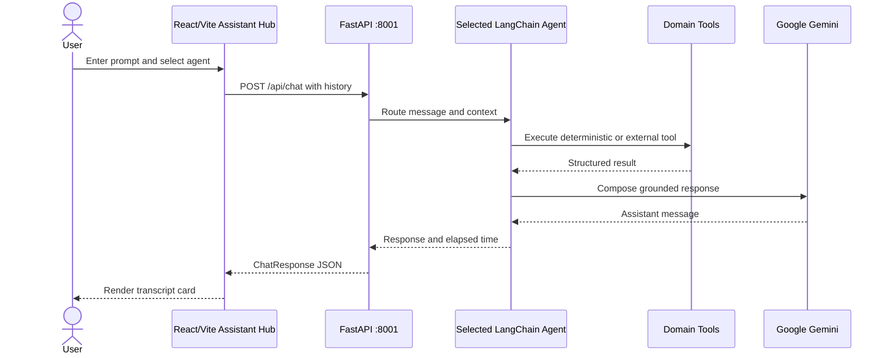

<div align="center">

```text
███╗   ███╗██╗   ██╗██╗  ████████╗██╗    █████╗  ██████╗ ███████╗███╗   ██╗████████╗
████╗ ████║██║   ██║██║  ╚══██╔══╝██║   ██╔══██╗██╔════╝ ██╔════╝████╗  ██║╚══██╔══╝
██╔████╔██║██║   ██║██║     ██║   ██║   ███████║██║  ███╗█████╗  ██╔██╗ ██║   ██║
██║╚██╔╝██║██║   ██║██║     ██║   ██║   ██╔══██╗██║   ██║██╔══╝  ██║╚██╗██║   ██║
██║ ╚═╝ ██║╚██████╔╝███████╗██║   ██║   ██║  ██║╚██████╔╝███████╗██║ ╚████║   ██║
╚═╝     ╚═╝ ╚═════╝ ╚══════╝╚═╝   ╚═╝   ╚═╝  ╚═╝ ╚═════╝ ╚══════╝╚═╝  ╚═══╝   ╚═╝
```

# Multi-Agent Productivity Assistant

**A modern, decoupled SaaS workspace powered by FastAPI, LangChain, Google Gemini, and React (shadcn/ui + Tailwind CSS).**


[Overview](#-overview) · [Features](#-features) · [Architecture](#-architecture) · [Setup](#-setup) · [Testing](#-testing)

</div>

---

## ✨ Overview

Multi-Agent Productivity Assistant is a decoupled full-stack workspace that
routes user prompts to focused AI specialists. Each specialist combines a
domain prompt with a small, testable toolset. Gemini handles reasoning and
response composition; deterministic Python tools handle calculations,
validation, planning, and external data access.

## 🚀 Features

- **Eight specialist agents** with isolated prompts and domain tools.
- **FastAPI orchestration API** with typed Pydantic request and response models.
- **React/Vite Assistant Hub** with responsive navigation, transcript, composer,
  memory toggle, prompt suggestions, and copy actions.
- **Tailwind and shadcn-style design system** using a slate/indigo palette.
- **Conversation history support** with bounded context passed to agents.
- **Explicit error handling** that surfaces actionable failures instead of
  silent success-shaped fallbacks.
- **Regression coverage** for rendering safety and tool input validation.

## 🧭 Specialist matrix

| Agent | Domain | Core tools |
| --- | --- | --- |
| 🌤️ Weather | Live conditions and forecasts | `get_current_weather`, `get_weather_forecast` |
| ✈️ Travel | Trip planning | `estimate_trip_budget`, `suggest_transport`, `travel_checklist`, `best_time_to_visit` |
| 💰 Finance | Financial calculations | `calculate_emi`, `simple_interest`, `compound_interest`, `monthly_budget_split` |
| 📋 Productivity | Work and planning | `create_todo_list`, `generate_meeting_agenda`, `draft_email`, `study_plan` |
| 💼 Career | Career development | `skill_gap_analysis`, `draft_outreach`, `resume_checklist` |
| 🏃 Health | General wellness | `bmi_report`, `calorie_targets`, `workout_split`, `hydration_and_sleep` |
| 🍳 Recipe | Cooking assistance | `scale_recipe`, `convert_kitchen_measure`, `cooking_times`, `shopping_list` |
| 📚 Study | Revision and exams | `grade_needed`, `pomodoro_plan`, `flashcards_from_notes`, `exam_revision_plan` |

> Health and finance responses are general informational guidance, not medical
> diagnosis or regulated financial advice.

## 🏗 Architecture



### API contract

| Method | Route | Purpose |
| --- | --- | --- |
| `GET` | `/api/agents` | List available specialists |
| `POST` | `/api/chat` | Route a message with optional history and memory |

Example request:

```json
{
  "agent_id": "productivity",
  "message": "Create a plan for my workday",
  "history": [],
  "remember": true
}
```

## 🧰 Technology matrix

| Layer | Technologies | Responsibility |
| --- | --- | --- |
| Runtime | Python 3.10+, Node.js | Application execution |
| API | FastAPI, Uvicorn, Pydantic | HTTP boundary and validation |
| Agents | LangChain 1.x, LangGraph 1.x | Tool calling and orchestration |
| Model | Gemini via `langchain-google-genai` | Reasoning and response generation |
| Data tools | Requests, OpenWeatherMap | External weather access |
| UI | React 18, TypeScript, Vite | Client application |
| Design | Tailwind CSS 3, Radix, Lucide | Styling and interaction primitives |

## 📂 Project structure

```text
Multi-Agent-Productivity-Assistant/
├── backend/
│   ├── agents/              # Eight specialist agent definitions
│   ├── tools/               # Domain-specific deterministic tools
│   ├── utils/
│   │   ├── agent_runtime.py # Shared invocation and error translation
│   │   └── llm.py           # Gemini initialization
│   ├── main.py              # FastAPI app and routes
│   ├── rendering.py         # Safe response rendering helper
│   └── requirements.txt
├── frontend/
│   ├── src/
│   │   ├── components/      # Assistant, chat, navigation, and UI components
│   │   ├── lib/api.ts       # Typed API client
│   │   ├── pages/           # AssistantPage
│   │   ├── main.tsx         # React entrypoint
│   │   └── styles.css       # Tailwind directives and theme tokens
│   ├── index.html
│   ├── package.json
│   ├── tailwind.config.cjs
│   ├── tsconfig.json
│   └── vite.config.ts
├── tests/test_regressions.py
├── .env.example
├── .gitignore
└── README.md
```

## 🛠 Setup

### 1. Clone the repository

```powershell
git clone https://github.com/ShubhamNegi-07/Multi-Agent-Productivity-Assistant.git
cd Multi-Agent-Productivity-Assistant
```

### 2. Configure environment variables

```powershell
Copy-Item .env.example .env
```

Set the values in `.env`:

```dotenv
GEMINI_API_KEY="your_gemini_api_key"
OPENWEATHER_API_KEY="your_openweathermap_key"
```

Never commit `.env`. It is excluded by the root `.gitignore`.

### 3. Install and run the backend

```powershell
python -m venv .venv
.\.venv\Scripts\Activate.ps1
python -m pip install -r backend\requirements.txt
python -m uvicorn backend.main:app --reload --port 8001
```

The API is served at `http://localhost:8001`.

### 4. Install and run the frontend

Open a second terminal:

```powershell
cd frontend
npm install
npm run dev
```

The Vite application is served at `http://localhost:5173`. The API client
defaults to `http://localhost:8001`; override it when needed:

```powershell
$env:VITE_API_BASE_URL = "http://localhost:8001"
npm run dev
```

## 🧪 Testing

Run the backend regression suite:

```powershell
python -m unittest discover -s tests -v
```

Compile Python modules:

```powershell
python -m compileall -q backend tests
```

Build and type-check the frontend:

```powershell
cd frontend
npm run build
```

Smoke-test the running services:

```powershell
Invoke-WebRequest http://localhost:8001/api/agents
Invoke-WebRequest http://localhost:5173
```

## 🔐 Security and development notes

- Keep API keys only in `.env`; do not paste secrets into source files or
  commits.
- Keep Python imports package-qualified with `backend.*`.
- Add new tools under `backend/tools/` and register them with one agent.
- Preserve regression tests when changing validation or response rendering.
- The frontend `@/*` alias resolves to `frontend/src/*`.

## 👤 Author

**ShubhamNegi-07**

- GitHub: [@ShubhamNegi-07](https://github.com/ShubhamNegi-07)
- Project: [Multi-Agent-Productivity-Assistant](https://github.com/ShubhamNegi-07/Multi-Agent-Productivity-Assistant)

<div align="center">

Made with Python, TypeScript, LangChain, Gemini, and a lot of deliberate tooling.

</div>
