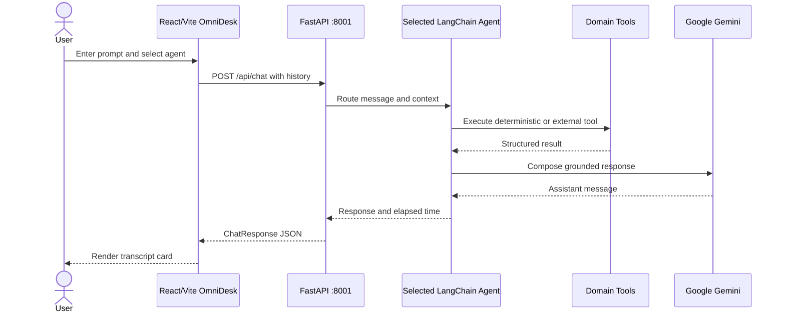

<div align="center">

```text
███╗   ███╗██╗   ██╗██╗  ████████╗██╗    █████╗  ██████╗ ███████╗███╗   ██╗████████╗
████╗ ████║██║   ██║██║  ╚══██╔══╝██║   ██╔══██╗██╔════╝ ██╔════╝████╗  ██║╚══██╔══╝
██╔████╔██║██║   ██║██║     ██║   ██║   ███████║██║  ███╗█████╗  ██╔██╗ ██║   ██║
██║╚██╔╝██║██║   ██║██║     ██║   ██║   ██╔══██╗██║   ██║██╔══╝  ██║╚██╗██║   ██║
██║ ╚═╝ ██║╚██████╔╝███████╗██║   ██║   ██║  ██║╚██████╔╝███████╗██║ ╚████║   ██║
╚═╝     ╚═╝ ╚═════╝ ╚══════╝╚═╝   ╚═╝   ╚═╝  ╚═╝ ╚═════╝ ╚══════╝╚═╝  ╚═══╝   ╚═╝
```

# OmniDesk

**A modern, decoupled SaaS workspace powered by FastAPI, LangChain, Google Gemini, and React (shadcn/ui + Tailwind CSS).**


[Overview](#-overview) · [Features](#-features) · [Architecture](#-architecture) · [Setup](#-setup) · [Testing](#-testing)

</div>

---

## ✨ Overview

OmniDesk is a decoupled full-stack workspace that
routes user prompts to focused AI specialists. Each specialist combines a
domain prompt with a small, testable toolset. Gemini handles reasoning and
response composition; deterministic Python tools handle calculations,
validation, planning, and external data access.

## 🚀 Features

- **Eight specialist agents** with isolated prompts and domain tools.
- **FastAPI orchestration API** with typed Pydantic request and response models.
- **React/Vite OmniDesk** with responsive navigation, transcript, composer,
  memory toggle, prompt suggestions, and copy actions.
- **Responsive workspace** for 320px+ mobile screens, 768px+ tablets, and
  1024px+ desktop layouts.
- **Mobile navigation drawer** with a hamburger trigger, backdrop, close action,
  agent selection, new-chat action, and context-memory toggle.
- **Adaptive chat composition** with mobile-safe spacing, rounded focus states,
  and quick-prompt cards that move from one to two to three columns.
- **Tailwind and shadcn-style design system** using a slate/indigo palette.
- **Conversation history support** with bounded context passed to agents.
- **Explicit error handling** that surfaces actionable failures instead of
  silent success-shaped fallbacks.
- **Regression coverage** for rendering safety and tool input validation.

## 🧭 Specialist matrix

| Desk | Domain | Core tools |
| --- | --- | --- |
| Weather Desk | Live conditions and forecasts | `get_current_weather`, `get_weather_forecast` |
| Travel Desk | Trip planning | `estimate_trip_budget`, `suggest_transport`, `travel_checklist`, `best_time_to_visit` |
| Finance Desk | Financial calculations | `calculate_emi`, `simple_interest`, `compound_interest`, `monthly_budget_split` |
| Planning Desk | Work and planning | `create_todo_list`, `generate_meeting_agenda`, `draft_email`, `study_plan` |
| Career Desk | Career development | `skill_gap_analysis`, `draft_outreach`, `resume_checklist` |
| Health Desk | General wellness | `bmi_report`, `calorie_targets`, `workout_split`, `hydration_and_sleep` |
| Kitchen Desk | Cooking assistance | `scale_recipe`, `convert_kitchen_measure`, `cooking_times`, `shopping_list` |
| Study Desk | Revision and exams | `grade_needed`, `pomodoro_plan`, `flashcards_from_notes`, `exam_revision_plan` |

> Health and finance responses are general informational guidance, not medical
> diagnosis or regulated financial advice.

## 🏗 Architecture



The application is split into two independently runnable services:

1. **React/Vite frontend** renders OmniDesk, loads the available
   specialists, manages local conversation state, and sends typed requests to
   the API. The desktop layout keeps the specialist navigation in a sidebar;
   screens below the `md` breakpoint use a slide-over drawer so the chat
   remains usable at 320px and wider.
2. **FastAPI backend** validates requests with Pydantic, exposes the agent
   catalog and chat route, bounds conversation context, loads the selected
   specialist, and translates runtime failures into explicit HTTP errors.
3. **Specialist agents and tools** pair each domain prompt with deterministic
   Python tools. Gemini composes the final answer while tools provide
   calculations, validation, planning, or external data access.

### Runtime flow

1. The frontend requests `GET /api/agents` and selects the first available
   specialist.
2. A user message and optional bounded history are sent to `POST /api/chat`.
3. FastAPI validates the payload and selects the requested specialist.
4. The agent invokes domain tools as needed and uses Gemini for response
   composition. Weather tools may call OpenWeatherMap.
5. The API returns the specialist metadata, response text, and elapsed time.
6. The frontend renders the response and retains non-error messages for the
   next request when memory is enabled.

### API contract

| Method | Route | Purpose |
| --- | --- | --- |
| `GET` | `/api/agents` | List available specialists |
| `POST` | `/api/chat` | Route a message with optional history and memory |

Example request:

```json
{
  "agent_id": "productivity",
  "message": "Create a plan for my workday",
  "history": [],
  "remember": true
}
```

## 🧰 Technology matrix

| Layer | Technologies | Responsibility |
| --- | --- | --- |
| Runtime | Python 3.10+, Node.js | Application execution |
| API | FastAPI, Uvicorn, Pydantic | HTTP boundary and validation |
| Agents | LangChain 1.x, LangGraph 1.x | Tool calling and orchestration |
| Model | Gemini via `langchain-google-genai` | Reasoning and response generation |
| Data tools | Requests, OpenWeatherMap | External weather access |
| UI | React 18, TypeScript, Vite | Client application |
| Design | Tailwind CSS 3, Radix, Lucide | Styling and interaction primitives |

## 📂 Project structure

```text
Multi-Agent-Productivity-Assistant/
├── backend/
│   ├── agents/              # Eight specialist agent definitions
│   ├── tools/               # Domain-specific deterministic tools
│   ├── utils/
│   │   ├── agent_runtime.py # Shared invocation and error translation
│   │   └── llm.py           # Gemini initialization
│   ├── main.py              # FastAPI app and routes
│   ├── rendering.py         # Safe response rendering helper
│   └── requirements.txt
├── frontend/
│   ├── src/
│   │   ├── components/      # Assistant, chat, navigation, and UI components
│   │   ├── lib/api.ts       # Typed API client
│   │   ├── pages/           # AssistantPage
│   │   ├── main.tsx         # React entrypoint
│   │   └── styles.css       # Tailwind directives and theme tokens
│   ├── index.html
│   ├── package.json
│   ├── tailwind.config.cjs
│   ├── tsconfig.json
│   └── vite.config.ts
├── tests/test_regressions.py
├── .env.example
├── .gitignore
└── README.md
```

## ✦ Design engineering skills

This repository includes Emil Kowalski's project-local design skills under
`.github/skills/emilkowalski-skills/`. Use `/emil-design-eng` for interface
craft and interaction decisions, `/animate` when implementing purposeful
motion, and `/review-animations` when auditing existing motion. The bundle
includes the original skill references and metadata for progressive loading.

## 🛠 Setup

### Prerequisites

- Python 3.10 or newer
- Node.js 18 or newer and npm
- A Google Gemini API key
- An OpenWeatherMap API key for live weather requests

### 1. Clone the repository

```powershell
git clone https://github.com/ShubhamNegi-07/Multi-Agent-Productivity-Assistant.git
cd Multi-Agent-Productivity-Assistant
```

### 2. Configure environment variables

```powershell
Copy-Item .env.example .env
```

Set the values in the root `.env` file:

```dotenv
GEMINI_API_KEY="your_gemini_api_key"
OPENWEATHER_API_KEY="your_openweathermap_key"
```

`GEMINI_API_KEY` powers reasoning for every specialist. `OPENWEATHER_API_KEY`
is used by the Weather Agent for current conditions and forecasts; the other
agents do not require it. Never commit `.env`; it is excluded by the root
`.gitignore`.

### 3. Install and run the backend

```powershell
python -m venv .venv
.\.venv\Scripts\Activate.ps1
python -m pip install -r backend\requirements.txt
python -m uvicorn backend.main:app --reload --port 8001
```

The API is served at `http://localhost:8001`.

### 4. Install and run the frontend

Open a second terminal:

```powershell
cd frontend
npm install
npm run dev
```

The Vite application is served at `http://localhost:5173`. During development,
API calls use the same-origin `/api` path and Vite proxies them to
`http://127.0.0.1:8001`. Override the API base URL only when the backend is
hosted elsewhere:

```powershell
$env:VITE_API_BASE_URL = "http://localhost:8001"
npm run dev
```

Open `http://localhost:5173` in a browser. The frontend and backend should be
running in separate terminals. If port `8001` is changed, set
`VITE_API_BASE_URL` before starting the frontend.

### Responsive behavior

| Viewport | Layout |
| --- | --- |
| 320px–767px | Full-width chat, compact header, hamburger-triggered navigation drawer, one-column prompt cards, and compact composer padding |
| 768px–1023px | Desktop-style specialist sidebar with two-column prompt cards where space allows |
| 1024px+ | Full desktop sidebar, three-column prompt cards, and expanded workspace spacing |

The page uses a minimum body width of 320px, bounded content widths, mobile
safe horizontal padding, and independently scrollable chat/sidebar regions.

## 🧪 Testing

Run the backend regression suite:

```powershell
python -m unittest discover -s tests -v
```

Compile Python modules:

```powershell
python -m compileall -q backend tests
```

Build and type-check the frontend:

```powershell
cd frontend
npm run build
```

The frontend build runs TypeScript compilation followed by a production Vite
bundle and is the quickest verification after UI or responsive-layout
changes.

Smoke-test the running services:

```powershell
Invoke-WebRequest http://localhost:8001/api/agents
Invoke-WebRequest http://localhost:5173
```

## 🔐 Security and development notes

- Keep API keys only in `.env`; do not paste secrets into source files or
  commits.
- Keep Python imports package-qualified with `backend.*`.
- Add new tools under `backend/tools/` and register them with one agent.
- Preserve regression tests when changing validation or response rendering.
- The frontend `@/*` alias resolves to `frontend/src/*`.

## 👤 Author

**ShubhamNegi-07**

- GitHub: [@ShubhamNegi-07](https://github.com/ShubhamNegi-07)
- Project: [Multi-Agent-Productivity-Assistant](https://github.com/ShubhamNegi-07/Multi-Agent-Productivity-Assistant)

<div align="center">

Made with Python, TypeScript, LangChain, Gemini, and a lot of deliberate tooling.

</div>
